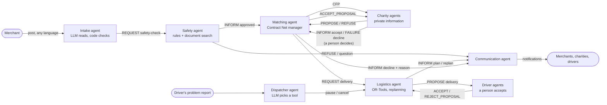

# ReFeed: a multi-agent food rescue platform

Every evening, shops and restaurants throw away food that is still good to eat, while charities a few streets away
need it. The problem is not a lack of food but a lack of coordination: charities do not know what is available,
where, or when, and today everything goes through slow phone calls.

ReFeed is a **multi-agent system** that closes that gap. A merchant posts leftover food; agents read the message,
check that the food is safe, let the charities bid for it, plan the drivers' routes, and re-plan on their own when
something goes wrong. People keep the last word at every important step: the charity accepts each donation, the
driver accepts each delivery, and a merchant confirms any food the safety rules are unsure about.

**The language model only reads language. Every decision (safety, award, routes, replanning, learning) is made by
algorithms we wrote**, and we measured them against today's phone-call process.

Academic project, team of two (Wassim Lourimi, Arij Belmabrouk). The interface and the code
use the working name "Food Rescue" (package `foodrescue`).

## Contents

1. [Install and run](#1-install-and-run)
2. [The platform](#2-the-platform)
3. [How a donation flows through the system](#3-how-a-donation-flows-through-the-system)
4. [The agents](#4-the-agents)
5. [Where each concept is in the code](#5-where-each-concept-is-in-the-code)
6. [What the language model does, and what it does not](#6-what-the-language-model-does-and-what-it-does-not)
7. [Food safety rules and their sources](#7-food-safety-rules-and-their-sources)
8. [Evaluation](#8-evaluation)
9. [Limitations](#9-limitations)
10. [Project layout](#10-project-layout)
11. [References](#11-references)

## 1. Install and run

Requirements: [uv](https://docs.astral.sh/uv/) (Python environment) and [Ollama](https://ollama.com) (local models).

```powershell
uv sync                          # creates .venv with Python 3.12 and installs the dependencies
ollama pull qwen3.5:9b-q4_K_M    # the language model (6.6 GB, fits an 8 GB GPU)
ollama pull bge-m3               # the embedding model used to search the safety documents (1.2 GB)
```

Start Ollama (`ollama serve`), then the platform:

```powershell
uv run streamlit run src/foodrescue/app/dashboard.py
```

The platform opens at http://localhost:8501. The side panel (top-left menu) is the presenter's panel: the evening's
clock (time buttons or **Live** mode, from one simulated minute every 5 seconds up to 5 minutes per second), the
"AI online" light, and "Start a new evening". Two switches let the agents answer for the charities and the drivers,
to fast-forward an evening.

**One evening for every device.** All browser tabs and devices share the same evening, and a page refresh keeps it.
To use a phone as a driver, connect it to the same Wi-Fi and open `http://<laptop IP>:8501` (the IP is shown by
`ipconfig`; Windows may ask to let Python through the firewall).

Command-line tools, without the interface:

```powershell
uv run python -m foodrescue run --scenario demo           # simulate the demo evening, print every agent message
uv run python -m foodrescue run --scenario random:7       # a randomly generated day (seed 7)
uv run python -m foodrescue run --protocol contract-net   # only show the charities' bidding
uv run python -m foodrescue run --rag --protocol safety-check   # safety verdicts explained with WHO/EU quotes
uv run python -m foodrescue compare                       # our system vs the phone-call baseline, same day
uv run python -m foodrescue.demo_check                    # checks the demo still works (prints READY TO DEMO)
```

The language model's answers to the demo messages are stored in `data/llm_cache/`: with the environment variable
`LLM_MODE=replay`, the command-line tools and the demo check run without Ollama.

## 2. The platform

One web application, one screen per role:

- **Merchant.** Posts leftover food with a short form: each food line says what it is, how much, and how it is kept
  (room temperature, fridge, hot, frozen), plus when it was cooked, its use-by date and the pickup window. Anything
  else is written freely in a details box ("the cakes have been out of the fridge since 15:00, the croissants contain
  almonds"). The merchant follows each donation step by step, answers the platform's questions, and sees why a
  charity declined.
- **Charity.** Keeps a private account: opening hours, how many kilos it can receive, fridge and freezer, the kinds
  of food it accepts and what it still needs today. Without a fridge, it cannot accept fresh dairy; without a fridge
  or a freezer, raw meat and fish. When its agent wins a donation, a person accepts it, or declines with a reason.
- **Driver.** Says what they drive (bike, car or truck) and how much it carries, sets their shift, and switches on
  or off duty. Each delivery is a request to accept within 5 minutes. The driver sees the current trip on a map of
  real streets, the trip history, and can report a problem in their own words.
- **Overview.** The operator's view: live map, drivers, every donation and where it stands, the agents' messages,
  and the Contract Net award for any donation.
- **Assessment.** What the evening achieved, counted from the agents' messages (food posted and delivered, meals,
  waiting times, what each agent decided, a CSV download), and the 100-day study against the phone-call baseline.

Notifications pop up on every screen as things happen: a charity won, a driver was asked, food was picked up or
delivered.

## 3. How a donation flows through the system

1. **Posting.** The merchant's post reaches the **intake agent**. The form is already structured; the free text is
   read by the local language model, which turns it into fixed fields (a time, allergens, a reported problem). Our
   code checks the result: it converts quantities and times, keeps allergens the model missed, and never takes a
   description for a safety confirmation.
2. **Safety.** The **safety agent** applies 12 rules, food by food, each tied to its source. Three outcomes: accept;
   remove an unsafe food, with an explanation that quotes the WHO or EU documents (the quote is checked against the
   document); or ask the merchant when only a person can decide (food out of the fridge, cooking time unknown). The
   merchant's answer is read with the original post.
3. **Bidding.** The **matching agent** sends a call for proposals to every charity. Each **charity agent** answers
   with its private information: it refuses with a reason (no room, no fridge, closes too early, does not take that
   food) or bids, explaining why in words. The best bid wins on need (50%), closeness (30%) and fairness (20%).
4. **Confirmation.** A person at the winning charity accepts. If they decline (with a reason) or do not answer within
   10 minutes, the next bidder is asked, and the merchant is told why.
5. **Routes.** The **logistics agent** plans every driver's route with OR-Tools (pickups and deliveries, time windows,
   vehicle capacity) and proposes the delivery to a driver. Nothing moves until the driver accepts; without an answer
   in 5 minutes it goes to another driver, and a delivery is never left with nobody to ask. The merchant and the
   charity are told only once a driver has accepted.
6. **Problems.** A driver who reports a problem in any language is read by the **dispatcher agent**, which picks one
   action: pause the driver, cancel the driver, or ask a question. Logistics then re-plans: what is done stays done,
   the rest is solved again, and food already in a car is never abandoned (another driver collects it).
7. **Delivery and assessment.** The **communication agent** tells each person what concerns them at each real event
   (picked up, delivered), with the merchant's note and allergens for the charity. The evening's results are counted
   from the agents' messages.

## 4. The agents



The agents never call each other: every message goes through our **message bus** (`core/bus.py`), with FIPA-ACL
performatives (CFP, PROPOSE, REFUSE, ACCEPT_PROPOSAL, REJECT_PROPOSAL, INFORM, REQUEST, CANCEL, FAILURE), a
conversation id (the donation) and a protocol name. A message sent at tick *t* is delivered at tick *t+1*, so results
never depend on the order in which agents run, and a simulated day is reproducible (same seed, same day). Every agent
runs the same cycle at each one-minute tick (`core/agent.py`): **perceive** (read its inbox), **decide** (no side
effects), **act** (send messages). Shared capabilities such as travel time go through a typed **tool registry**
(`core/tools.py`), which also gives the language model the JSON schemas of the dispatcher's tools. We wrote this
framework ourselves, without an agent library.

### PEAS description

| Agent | Performance measure | Environment | Actuators | Sensors | Type |
|---|---|---|---|---|---|
| **Intake** | Fields read correctly, nothing invented | Merchant posts in any language | Structured donation to safety; question to the merchant | Posts, merchant answers | LLM reading with code checks |
| **Safety** | No unsafe food approved, every verdict justified | Donations, rule book, WHO/EU documents | Accept, remove a food, ask the merchant; cited explanation | Donations from intake | Knowledge-based (rules) + document search (RAG) |
| **Matching** | Food to the charity that needs it, fairly, with few declines | Charities' bids, merchants' locations | Calls for proposals, awards, re-awards, delivery requests | Bids, refusals, accepts, declines | Deliberative (Contract Net manager) + learning |
| **Charity** (one per charity) | Receive what it needs and can store | Its private capacity, storage, needs, hours | Bid with reasons, refuse with a reason, accept or decline | Calls for proposals, awards | Self-interested participant; a person confirms |
| **Logistics** | Safe kilos delivered in time, few km, short waits | Drivers, roads, time windows | Routes, re-plans, transfers from broken-down cars | Delivery requests, driver answers, disruptions | Deliberative planner with rolling-horizon replanning |
| **Driver** (one per driver) | Take the deliveries it can do, answer in time | Requests, its availability and vehicle | Accept or decline, go on or off duty | Requests from logistics | Reactive; a person answers |
| **Dispatcher** | Right reaction to a problem, never a risky guess | Drivers' reports in any language | One tool: pause, cancel or ask | Problem reports | LLM tool use, validated, cautious fallback |
| **Communication** | Everyone concerned is informed, in plain words | Merchants, charities, drivers | Notifications, questions | Plans, re-plans, verdicts, declines | Reactive |

### Properties of the environment

| Property | Here | Why |
|---|---|---|
| Observability | **Partially observable** | A charity's capacity, storage and preferences are private; future donations and disruptions are unknown. |
| Determinism | **Stochastic** | Donations, cancellations, late merchants and declines are random (seeded in the simulation). |
| Episodic / sequential | **Sequential** | Today's assignments constrain later donations; learning carries over from day to day. |
| Static / dynamic | **Dynamic** | The world changes while agents plan (new posts, breakdowns): hence replanning. |
| Discrete / continuous | **Discrete time** (one-minute ticks), continuous space (GPS coordinates) | |
| Single / multi-agent | **Multi-agent**, cooperative system with self-interested participants | Private information is what makes the Contract Net useful. |
| Known / unknown | **Partly unknown** | Which charities really accept which food must be learned. |

## 5. Where each concept is in the code

Paths are relative to `src/foodrescue/`.

| Concept | Code | In one sentence |
|---|---|---|
| Agent loop | `core/agent.py` | Perceive, decide, act at every tick. |
| Message bus, FIPA performatives | `core/bus.py`, `models.py` | Delivery at the next tick, groups (`@charities`), full log. |
| Tool registry | `core/tools.py`, `toolbox.py` | Typed tools with JSON schemas. |
| Simulated environment | `sim/runner.py`, `sim/generator.py`, `core/clock.py` | Events injected tick by tick; seeded random days. |
| **Contract Net** | `agents/matching.py`, `agents/charity.py` | Call for proposals, bids with private information, award, accept or decline, next bidder. |
| Award score | `optim/scoring.py` | Need 50% + closeness 30% + fairness 20%. |
| **Vehicle routing (PDPTW)** | `optim/routing.py` | OR-Tools with pickup-delivery pairs, time windows, capacity and drop penalties. |
| **Rolling-horizon replanning** | `agents/logistics.py` | Freeze the past, solve the future again; food on board is never abandoned. |
| Driver requests | `agents/driver.py`, `agents/logistics.py` | A person accepts each delivery; 5-minute expiry; a decline is final, an expiry is retried. |
| **Knowledge-based safety rules** | `safety/rules.py`, `data/safety/rules.yaml` | 12 rules with sources, judged food by food with each food's own storage. |
| **Retrieval-augmented generation** | `rag/corpus.py`, `rag/index.py`, `rag/explain.py` | WHO and EU documents in 238 passages, bge-m3 embeddings (BM25 fallback), quotes checked. |
| **LLM information extraction** | `llm/extraction.py`, `llm/details.py`, `llm/normalize.py`, `llm/client.py` | JSON-schema output, retries, cache; code converts units and times. |
| **LLM tool use** | `agents/dispatcher.py`, `llm/dispatch.py` | The model picks a tool from our registry; invalid calls fall back to a safe action. |
| **Learning (multi-armed bandit)** | `learning/bandit.py` | Beta beliefs per charity and food kind, Thompson sampling. |
| Human in the loop | `agents/intake.py`, `agents/charity.py`, `agents/driver.py` | Questions to merchants, charities' and drivers' acceptance. |
| Baseline | `baseline/greedy.py` | Phone calls: nearest charity that says yes, first free driver, no replanning. |
| Metrics and comparison | `sim/metrics.py`, `sim/compare.py` | The same measures for every system, on the same days. |
| Platform | `app/` | Streamlit interface: one screen per role, shared evening, maps. |

## 6. What the language model does, and what it does not

The model runs locally (`qwen3.5:9b` through Ollama): no data leaves the machine.

| The language model | Our code |
|---|---|
| Reads the merchant's free text into fixed fields: out of the fridge since, cooking time, product date, allergens, problems, confirmation | Converts quantities to kilos and resolves times; keeps allergens the model missed; accepts a confirmation only in an answer to our question; sends what it could not read to a person |
| Writes a short explanation of a safety decision and quotes a passage | Retrieves the passages, checks the quote is really in them, falls back to the rule's text otherwise |
| Reads a driver's problem report and picks one tool (pause, cancel, ask) | Validates the call, executes it, re-plans; an invalid call is treated as a cancellation |
| Transcribed the WHO pages that had no text layer (vision), checked by hand against the page images | Makes every decision: safety, award, routes, replanning, learning |

The model never makes a decision that matters for safety or logistics, and every feature that uses it still works
without it: the form is enough, rule texts replace explanations, keyword search replaces embeddings, and recorded
answers replay the demo offline.

## 7. Food safety rules and their sources

The 12 rules are in `data/safety/rules.yaml`. Every citation was checked against its source:

| Rules | What they say | Source |
|---|---|---|
| R01 | No donation after the use-by date | Regulation (EU) 1169/2011, art. 24, and the EU food donation guidelines |
| R02 | After the best-before date, allowed if safe (with a warning) | EU food donation guidelines |
| R03, R06, R07 | Cooked food: at most 2 hours at room temperature; keep hot food hot; keep perishable food cold | WHO, Five Keys to Safer Food, Key 4 (PDF page 19) |
| R04, R05 | Cooking time unknown: ask, because the 2-hour limit cannot be checked | Derived from WHO Key 4 |
| R08, R09 | Refrigerated leftovers within 2 days; cooked rice within 1 day | UK Food Standards Agency (gov.uk) |
| R10 | Refrigerated cooked food of unknown age: serve it first | WHO Key 4 |
| R11 | A problem reported by the merchant is checked by a person | Our own platform policy, labelled as such |
| R12 | Food out of the fridge for more than 2 hours: ask the merchant | WHO Key 4 |

WHO allows leftovers 3 days in the fridge (Key 4, PDF page 20); we keep the stricter FSA limit of 2 days. The texts
searched by the safety agent are in `data/safety/docs/` (the WHO manual and the EU guidelines, as text); WHO pages 14
to 22 had no text layer and were transcribed with the local vision model, then compared by hand with the page images.

## 8. Evaluation

The evaluation was run during development on simulated days (the charts are in `data/figures/` and in the platform's
Assessment tab). The city is simulated by us, so these results are indicative: they compare two systems under the
same conditions, not a promise about a real city.

### Our system against phone calls (100 simulated days per level, paired, 95% confidence intervals)

| Disruption | Ours | Phone calls | Difference | Without replanning | Without bidding |
|---|---|---|---|---|---|
| None | 91.3% | 90.6% | +0.7 ± 2.0 (not significant) | 91.3% | 64.7% |
| 1 driver cancels | 85.0% | 83.0% | +2.0 ± 2.3 (not significant) | 80.9% | 64.0% |
| 2 drivers cancel | 73.3% | 69.1% | **+4.3 ± 2.5** | 66.7% | 58.9% |
| 1 cancels + 3 late merchants | 83.7% | 81.9% | +1.7 ± 2.2 (not significant) | 80.4% | 62.7% |

*Share of the safe food delivered in time.*

- **On a normal day, phone calls do about as well.** Our advantage appears when things go wrong, and removing
  replanning shows that is where it comes from (−4 to −7 points without it under disruption).
- **Asking the charities is essential:** without the bidding, 10 to 26 points are lost.
- Fewer kilometres per kilo under disruption, but **merchants wait 7 to 11 minutes longer**, because pickups are
  grouped into efficient routes.

### Other results

- **Sensitivity.** Changing one setting of the simulated city at a time (9 settings × 100 days): with at least one
  cancellation, our gain is positive in 15 of 17 settings, significant in 9, never significantly negative. It grows on
  busy evenings (+6 points with 25 posts) and disappears in slow traffic (15 km/h), where we are worse on easy days
  (−2.9 ± 2.4).
- **Routing on a public benchmark.** On the 56 Li & Lim pickup-and-delivery instances, against the best known
  solutions published by SINTEF: all our solutions are valid; with our 2-second search we find the best known
  solution on 9 instances, use 1.2 more vehicles and drive 17% more on average; a 30-second search halves the gap.
- **Learning.** Over 10 simulated cities × 30 days, declined awards fall from 29% to 16.5% with Thompson sampling,
  close to an oracle that knows the hidden preferences (14.5%). The food rescued does not change, because declines
  are re-awarded within minutes.
- **Reading merchants' posts.** On 60 labelled messages (French, English, Arabic, Tunisian dialect), `qwen3.5:9b`
  reads 94% of the fields right and 66.7% of the messages entirely right (`qwen3.5:4b`: 90.8% and 51.7%). Tunisian
  dialect in Latin letters is the weak spot.
- **Reading the details box.** On 16 held-out messages written after the prompt was fixed, 75% are read entirely
  right with our checks; allergens and confirmations 100%; product dates 87.5%.
- **Dispatcher.** On 32 labelled driver reports, the model picks the right action for 91% (always cancelling: 28%).
  Reading reports perfectly (pausing drivers who will come back instead of cancelling them) rescues +7.1 ± 2.3 points
  of safe food over 100 days with 2 incidents a day: an upper bound, since the model is not perfect.

## 9. Limitations

- **The city is simulated.** Planning uses straight-line distances × 1.3 at 25 km/h; donations and disruptions are
  random. The demo evening uses real places in Tunis, but what they offer and need is invented. The map draws trips
  along real streets (OSRM), while the planning still uses the straight-line estimate.
- **We built both the simulated city and the baseline.** Both systems get the same days, rules and data, the
  baseline gets a favourable assumption (no knock-on delays), we tested other city settings, and we measured the
  routing on a public benchmark.
- **On a normal day, our system does not beat phone calls**, and merchants wait longer for their pickup.
- **The routing search is fast, not optimal** (17% more distance than the best known solutions on the benchmark).
- **The test messages were written by us**, following the same labelling rules as the prompt, and have not been
  reviewed by outside readers. Tunisian dialect remains hard for the model.
- **The details box is read for the whole donation**: "the cakes are out of the fridge" applies to every food line of
  that post (the merchant is then asked, so a person decides).
- **The vehicle only changes the load**: a bike drives as fast as a truck in the planning.
- **The 100-day study uses simulated charity answers**; the person who accepts or declines exists only in the
  platform.
- **The safety rules come from general guidance** (WHO, EU, UK FSA), not from Tunisian regulation.

## 10. Project layout

| Path | What it holds |
|---|---|
| `src/foodrescue/core/` | Our agent framework: message bus, agent loop, clock, tool registry |
| `src/foodrescue/agents/` | The agents: intake, safety, matching, charity, logistics, driver, dispatcher, communication |
| `src/foodrescue/llm/` | Ollama client (JSON output, retries, cache), extraction, details reading, dispatcher prompt |
| `src/foodrescue/rag/` | Document passages, embeddings index, cited explanations |
| `src/foodrescue/safety/` | The rule engine |
| `src/foodrescue/optim/` | Geography, routing (OR-Tools), award score |
| `src/foodrescue/learning/` | Thompson sampling of charities' acceptance |
| `src/foodrescue/baseline/` | The phone-call baseline |
| `src/foodrescue/sim/` | Scenarios, random days, simulation runner, metrics, comparison, message trace |
| `src/foodrescue/app/` | The platform (Streamlit): dashboard, one screen per role, maps |
| `src/foodrescue/demo_check.py` | Checks that the demo evening still works, offline too |
| `config/default.yaml` | Models, parameters and feature switches |
| `data/scenarios/` | The registered accounts (real places in Tunis) and the demo evening |
| `data/safety/` | Safety rules, the source documents as text, the embeddings index |
| `data/llm_cache/` | Recorded model answers for the demo (offline replay) |
| `data/streets_cache/` | Street shapes for the map |
| `data/figures/` | Charts of the evaluation, shown in the Assessment tab |
| `data/impact.yaml` | Meal equivalent (420 g per meal) and its source |
| `.streamlit/config.toml` | Interface theme, and access from other devices on the network |

## 11. References

**Food safety**

- World Health Organization (2006). *Five Keys to Safer Food Manual*. https://iris.who.int/handle/10665/43546
- European Commission (2017). *EU guidelines on food donation*, Commission Notice 2017/C 361/01.
  https://eur-lex.europa.eu/legal-content/EN/TXT/?uri=CELEX:52017XC1025(01)
- Regulation (EU) No 1169/2011 on the provision of food information to consumers, article 24 and annex II.
- UK Food Standards Agency. *Student guide to food safety and hygiene* (gov.uk, 2026) and *How to chill, freeze and
  defrost food safely* (2017).

**Impact**

- WRAP (2020). *Reporting on the amounts of food surplus redistributed (weight and meal equivalents)*: 420 g per meal.

**Data and services**

- Li & Lim pickup-and-delivery benchmark and best known solutions, SINTEF Transportation Optimization Portal.
  https://www.sintef.no/projectweb/top/pdptw/
- Google Maps (places of the demo evening), OpenStreetMap contributors (map), OSRM (street paths).

**Methods**

- Russell, S. and Norvig, P. (2020). *Artificial Intelligence: A Modern Approach*, 4th edition. Pearson.
- Smith, R. G. (1980). The Contract Net Protocol. *IEEE Transactions on Computers*, C-29(12), 1104–1113.
- Foundation for Intelligent Physical Agents (2002). *FIPA ACL Message Structure Specification* (SC00061G) and *FIPA
  Contract Net Interaction Protocol Specification* (SC00029H).
- Li, H. and Lim, A. (2001). A Metaheuristic for the Pickup and Delivery Problem with Time Windows. *ICTAI 2001*.
- Thompson, W. R. (1933). On the Likelihood that One Unknown Probability Exceeds Another in View of the Evidence of Two
  Samples. *Biometrika*, 25(3/4), 285–294.
- Lewis, P. et al. (2020). Retrieval-Augmented Generation for Knowledge-Intensive NLP Tasks. *NeurIPS 33*.
- Robertson, S. and Zaragoza, H. (2009). The Probabilistic Relevance Framework: BM25 and Beyond. *Foundations and
  Trends in Information Retrieval*, 3(4).

**Models and software**

- Qwen3.5 (Qwen team, Alibaba Cloud); BGE-M3 (Chen et al., 2024, arXiv:2402.03216); Ollama; Google OR-Tools;
  Streamlit; Folium and Leaflet; Altair; pandas; NumPy; Pydantic.
